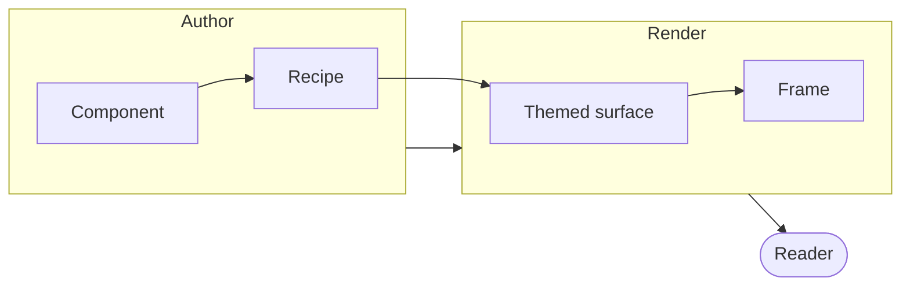

A page sometimes needs a picture of a shape — a pipeline, a lifecycle, a chain of
packages — and prose is the wrong tool for it. Diagrams renders
[Mermaid](https://mermaid.js.org) with [Pele](https://pele.run), a synchronous
renderer with no runtime dependency, so the drawing is in the prerendered HTML:
a reader gets the picture before any script runs.

## A fence is the whole API

A ` ```mermaid ` code fence is a diagram. Nothing else is needed, and the fence
stays source — a page that wants the Mermaid text as text wraps it in a plain
fence.



The source behind that picture is the diagram's own text:

```text
flowchart LR
  subgraph author[Author]
    component[Component] --> recipe[Recipe]
  end
  subgraph render[Render]
    recipe --> themed[Themed surface]
    themed --> frame[Frame]
  end
  author --> render
  render --> reader([Reader])
```

## Themed from the page, not from the diagram

Pele paints through `--pele-*` custom properties, and this site maps every one of
them to its own role:

| Pele | The page's role |
| --- | --- |
| `--pele-bg` | `--card` |
| `--pele-fg` | `--foreground` |
| `--pele-muted` | `--muted-foreground` |
| `--pele-line` | `--border-strong` |
| `--pele-surface` | `--muted` |
| `--pele-accent` | `--ring` |
| `--pele-border` | `--border` |

Every value is a `var()` reference, so the diagram is rendered once and the
surface it sits on decides its colours. Switching between light and dark
re-themes the same SVG — there is no second render, and no image to re-export.

## A diagram that does not parse

The source is user text, so a broken diagram is a typed failure, not a thrown
page: the parser's sentence is printed with the source under it, because a
diagram you cannot see is a source you have to fix.

```mermaid
this is not a diagram
```

## Why the library does not ship one

A GPUix surface cannot paint a Mermaid diagram. The runtime's `<svg source>`
paints its whole markup **as one tint** — the markup is masked in the element's
colour, so a shape's own `fill` never reaches the frame — and a diagram is many
colours. The library's other vector route decodes SVG **bytes** through
`ImgInstance.setImage`, which does paint every fill its own colour, but an image
cannot be re-themed by a custom property, cannot be selected, and cannot carry a
link.

The docs site is a browser, so it takes the SVG as markup. That is why Diagrams
is a page about the documentation rather than a component.
