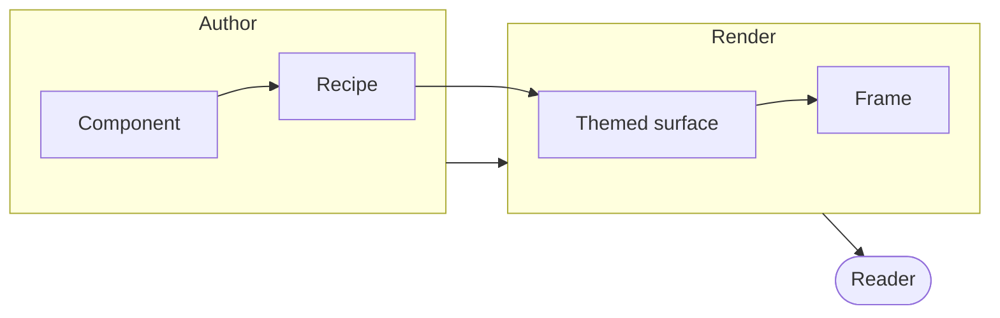

A fence tagged `mermaid` is the whole API. [Pele](https://pele.run) renders it at
build time, so the drawing is in the HTML and the fence stays copyable.



| Pele role | The page's role |
| --- | --- |
| `--pele-bg` | `--card` |
| `--pele-fg` | `--foreground` |
| `--pele-muted` | `--muted-foreground` |
| `--pele-line` | `--border-strong` |
| `--pele-surface` | `--muted` |
| `--pele-accent` | `--ring` |
| `--pele-border` | `--border` |

Every value is a `var()`, so the surface decides the colours.

A source Pele cannot read prints the parser's sentence with the source under it:

```mermaid
this is not a diagram
```

## The renderer

The docs also ship the [mermaidcn](https://github.com/Riley1101/mermaidcn)
components, rebuilt on Pele: the same `chart` prop, the same theme names and the
same eight Mermaid variables, with Pele's synchronous render underneath. The
drawing below is live — zoom it with the wheel or the buttons, and pan it with a
drag.

<MermaidExample />

```tsx
import { Mermaid } from "@/components/mermaidcn/Mermaid";
import { ZoomPan } from "@/components/mermaidcn/ZoomPan";

<ZoomPan
  controls={({ zoomIn, zoomOut, resetZoom, centerView, scalePercent }) => (
    <>…</>
  )}
>
  <Mermaid chart={source} config={{ theme: "ocean" }} />
</ZoomPan>;
```

### `Mermaid`

| Prop | Type | Default |
| --- | --- | --- |
| `chart` | `string` | required |
| `config.theme` | `"default" \| "dark" \| "forest" \| "neutral" \| "base"` or a named palette | `"default"` |
| `config.themeVariables` | `Partial<MermaidThemeVariables>` | none |
| `config.fontFamily` | `string` | Pele's default |
| `config.fontSize` | `number` | Pele's default |
| `config.maxWidth` | `number` | none |
| `config.responsive` | `boolean` | `true` |
| `label` | `string` | `"Diagram"` |
| `onSuccess` | `(svg: string) => void` | none |
| `onError` | `(message: string) => void` | none |
| `className` | `string` | — |

`themeVariables` keeps Mermaid's names (`primaryColor`, `primaryTextColor`,
`primaryBorderColor`, `background`, `textColor`, `lineColor`,
`secondaryColor`, `tertiaryColor`) and maps them to Pele's roles, so a config
copied from mermaidcn keeps working. A variable Pele has no role for is ignored
rather than painted as a property nothing reads.

## The playground

The playground is the whole mermaidcn loop: edit the source, switch a template,
pick a theme, then zoom, fit or reset the preview. Copy and download take the
rendered SVG Pele produced.

<MermaidPlayground />

```tsx
import { MermaidPlayground } from "@/components/mermaidcn/MermaidPlayground";

<MermaidPlayground defaultValue={source} />;
```

The preview renders one deferred value behind the editor, so typing stays
smooth while the diagram still follows the source. Pele is synchronous, so the
picture appears on the same render as its source; there is no spinner state to
show.

## Themes

`default` reads the page's roles, so it follows the light/dark switch without a
second render. A named theme sets the `--pele-*` properties on the diagram's
wrapper; the SVG is not rendered again.

| Theme | Character |
| --- | --- |
| `default` | the page's own roles |
| `dark` | slate surfaces and near-white ink |
| `forest` | green surfaces on a pale page |
| `neutral` | grey, no hue |
| `base` | indigo accent |
| `emerald`, `teal`, `lime`, `mint` | green family |
| `coral`, `amber`, `crimson`, `bronze` | warm family |
| `ocean`, `sky`, `indigo` | cool family |
| `violet`, `rose` | purple / pink |
| `slate`, `charcoal` | dark family |

## Limits

- **Pele is the renderer, not Mermaid.js.** Pele targets Mermaid 12.1.0 syntax
  with its own layout and visual style. Mermaid's `look: "handdrawn"` and its
  `flowchart`/`sequence` config keys are not part of Pele's contract; the theme
  is CSS variables, not a renderer config.
- **Pinch is not in the React wrapper.** Wheel, drag and the buttons are
  implemented. Pele's own `enableZoom` carries pinch when the canvas is a Pele
  mount rather than React content.
- **The playground exports SVG only.** Copy and download hand back Pele's SVG;
  a PNG would need a canvas raster step and is not part of this pass.
- **A malformed diagram is a sentence, not a picture.** The renderer shows the
  parser's message instead of an empty frame.
