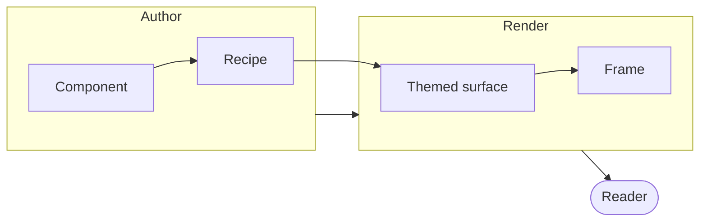

A fence tagged `mermaid` is the whole API. [Pele](https://pele.run) renders it at
build time, so the drawing is in the HTML and the fence stays copyable.



| Pele role | The page's role |
| --- | --- |
| `--pele-bg` | `--card` |
| `--pele-fg` | `--foreground` |
| `--pele-muted` | `--muted-foreground` |
| `--pele-line` | `--border-strong` |
| `--pele-surface` | `--muted` |
| `--pele-accent` | `--ring` |
| `--pele-border` | `--border` |

Every value is a `var()`, so the surface decides the colours.

A source Pele cannot read prints the parser's sentence with the source under it:

```mermaid
this is not a diagram
```

## The `Diagram` component

A **diagram** is a drawing, and
[the `Diagram` component](/components/diagram) is what draws one. You give it
a Mermaid source and it renders the diagram, themed in the library's own
colours.

The renderer is [Pele](https://pele.run) — a zero-dependency Mermaid renderer
that needs no DOM. Measured in a plain Node process, with `typeof document` and
`typeof window` both `undefined`, a flowchart rendered to a 403×64 SVG.

```tsx
import { Diagram } from "@gpuixui/components/diagram";

<Diagram
  aria-label="The render path"
  source={"flowchart LR\n  A[Author] --> B[Component]"}
  caption="How a component becomes a picture"
/>;
```

### The theme roles

The component reads the theme's colours and **bakes them into** the drawing as
literal values, because a raster resolves no custom property — and Pele writes
its palette twice, as the public `--pele-*` set and an internal `--_*` set.

| Pele role | The library's role |
| --- | --- |
| `--pele-bg` | `card` |
| `--pele-fg` | `foreground` |
| `--pele-muted` | `muted-foreground` |
| `--pele-line` | `border-strong` |
| `--pele-surface` | `muted` |
| `--pele-surface-alt` | `accent` |
| `--pele-accent` | `primary` |
| `--pele-border` | `border` |

The three roles that are not colours — `--pele-radius`, `--pele-font` and
`--pele-font-mono` — are given literal values, because a raster carries no
font of its own.

## Interactive diagrams

The same Pele render, with a zoom/pan canvas. The drawing below is live — wheel
or the buttons to zoom, drag to pan.

<DiagramExample />

```tsx
import { DiagramView } from "@/components/diagram/DiagramView";
import { ZoomPan } from "@/components/diagram/ZoomPan";

<ZoomPan
  controls={({ zoomIn, zoomOut, resetZoom, centerView, scalePercent }) => (
    <>…</>
  )}
>
  <DiagramView chart={source} config={{ theme: "ocean" }} />
</ZoomPan>;
```

### `DiagramView`

| Prop | Type | Default |
| --- | --- | --- |
| `chart` | `string` | required |
| `config.theme` | `"default" \| "dark" \| "forest" \| "neutral" \| "base"` or a named palette | `"default"` |
| `config.themeVariables` | `Partial<DiagramThemeVariables>` | none |
| `config.fontFamily` | `string` | Pele's default |
| `config.fontSize` | `number` | Pele's default |
| `config.maxWidth` | `number` | none |
| `config.responsive` | `boolean` | `true` |
| `label` | `string` | `"Diagram"` |
| `onSuccess` | `(svg: string) => void` | none |
| `onError` | `(message: string) => void` | none |
| `className` | `string` | — |

`themeVariables` keeps Mermaid's names (`primaryColor`, `primaryTextColor`,
`primaryBorderColor`, `background`, `textColor`, `lineColor`,
`secondaryColor`, `tertiaryColor`) and maps them to Pele's roles, so a config
copied from Mermaid keeps working. A variable Pele has no role for is ignored
rather than painted as a property nothing reads.

## Playground

Edit the source, switch a template, pick a theme, then zoom, fit or reset. Copy and download take the
rendered SVG Pele produced.

<DiagramPlayground />

```tsx
import { DiagramPlayground } from "@/components/diagram/DiagramPlayground";

<DiagramPlayground defaultValue={source} />;
```

The preview renders one deferred value behind the editor, so typing stays
smooth while the diagram still follows the source. Pele is synchronous, so the
picture appears on the same render as its source; there is no spinner state to
show.

## Themes

`default` reads the page's roles, so it follows the light/dark switch without a
second render. A named theme sets the `--pele-*` properties on the diagram's
wrapper; the SVG is not rendered again.

| Theme | Character |
| --- | --- |
| `default` | the page's own roles |
| `dark` | slate surfaces and near-white ink |
| `forest` | green surfaces on a pale page |
| `neutral` | grey, no hue |
| `base` | indigo accent |
| `emerald`, `teal`, `lime`, `mint` | green family |
| `coral`, `amber`, `crimson`, `bronze` | warm family |
| `ocean`, `sky`, `indigo` | cool family |
| `violet`, `rose` | purple / pink |
| `slate`, `charcoal` | dark family |

## Limits

- **Pele is the renderer, not Mermaid.js.** Pele targets Mermaid 12.1.0 syntax
  with its own layout and visual style. Mermaid's `look: "handdrawn"` and its
  `flowchart`/`sequence` config keys are not part of Pele's contract; the theme
  is CSS variables, not a renderer config.
- **Pinch is not in the React wrapper.** Wheel, drag and the buttons are
  implemented. Pele's own `enableZoom` carries pinch when the canvas is a Pele
  mount rather than React content.
- **The playground exports SVG only.** Copy and download hand back Pele's SVG;
  a PNG would need a canvas raster step and is not part of this pass.
- **A malformed diagram is a sentence, not a picture.** The renderer shows the
  parser's message instead of an empty frame.

## The category

This is the **Graphics** category: the things the library draws.

| Page | What it is |
| ---- | ---------- |
| [Charts](/graphics/charts/charts) | bar, line, area, pie, radar and radial charts, on the GPU |
| [Icons](/graphics/icons/icon) | the glyph set and its two accessibility rules |
| [Diagrams](/graphics/diagrams) | this page — the `Diagram` component |

The charts are [TanStack Charts](https://github.com/TanStack/charts)' scene
compiler, compiled to a document the runtime's own renderer paints; the icons
are the library's own set; the diagrams are Pele's renderer, on the same
document route. One category, one paint path.
