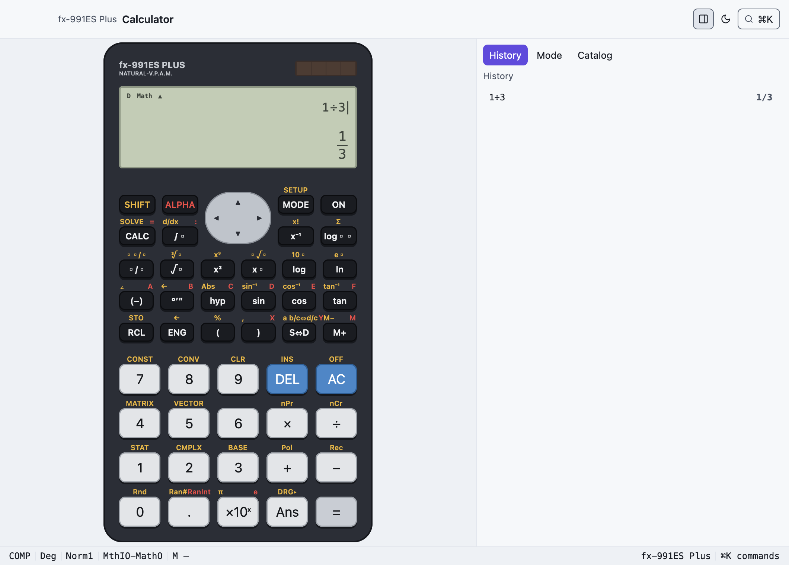
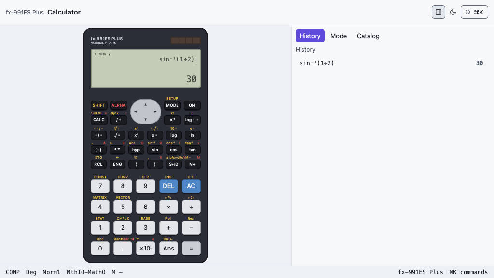
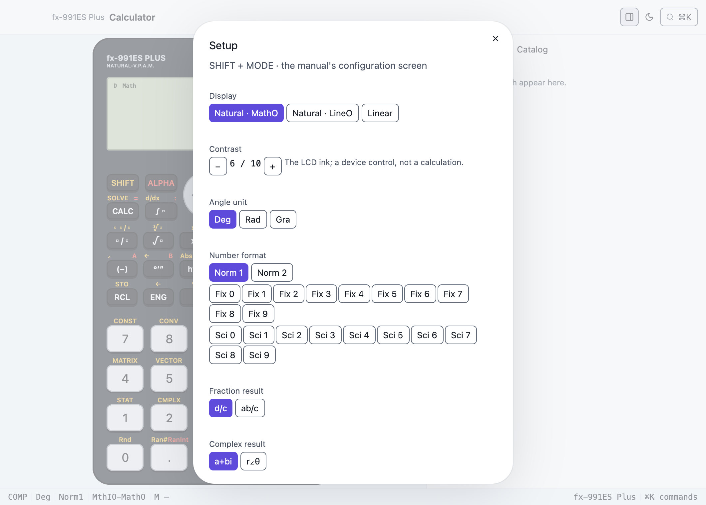

# Calculator — a native fx-991ES Plus

The Casio **fx-991ES Plus** as you know it, rendered by GPUix through
`@gpuixui/*`: the graphite body, the grey-green LCD, the familiar key grid with
its gold SHIFT and red ALPHA legends, every mode in the manual, full keyboard
control, a ⌘K palette over every function, constant and setup command, and a
side panel (history, the mode's editor, the catalogue) that folds away. The
same tree runs in a kitty/Ghostty terminal.







## Run it

```sh
nub run --filter @gpuixui/calculator dev          # native window
nub run --filter @gpuixui/calculator terminal     # kitty / Ghostty
nub run --filter @gpuixui/calculator dev -- --dark
```

`GPUIX_TERMINAL=1` is equivalent to the terminal flag; `GPUIX_DARK=1` starts in
dark. The terminal run paints the same app: the traffic-light reserve drops, and
the frame is transmitted with the kitty graphics protocol.

The mount is `src/main.tsx` — the only file that executes anything. Window
options come from `nativeWindowOptions(theme, currentPlatform)`; the app owns the
appearance and restyles every token-driven surface.

## The device

The keypad is `fx991es.keypad`, laid out as the body is: SHIFT, ALPHA, CALC
and ∫ left of the round replay pad, MODE, ON, x⁻¹ and log▫▫ right of it, three
rows of small function keys, four rows of large keys. Every legend printed
above a key does what it says: SHIFT RCL is STO, SHIFT hyp is Abs, ALPHA (−) is
A, RCL then (−) recalls A, and in CMPLX the ENG key enters `i`.

- **MODE** lists `1:COMP … 8:VECTOR` on the LCD; a digit picks, AC leaves.
- **SHIFT MODE** (SETUP) and **SHIFT 9** (CLR) open SETUP and its resets.
- **SHIFT 7 / 8** (CONST, CONV) open the catalogue; **SHIFT 1–5** open the
  STAT, CMPLX, BASE-N, MATRIX or VECTOR panel.
- **SHIFT AC** powers the LCD off; any key wakes it.

Printed but not yet wired (`// TODO:` in `packages/calc/src/model.test.ts`):
mixed fractions (SHIFT ▫/▫), INS, DRG▸, the sexagesimal `←` and a b/c⇔d/c.
ENG and SHIFT ENG switch engineering notation on and off rather than stepping
the exponent.

The device keeps its physical colours in light and dark; the window around it
follows the theme. It is laid out in one unit fitted to the space it gets, so a
small window or a terminal shows the whole device.

## Controls

| Input | Action |
| ----- | ------ |
| digits, `.` `+` `−` `×` `÷` `^` `( )` `,` | entry |
| Enter / Escape / Backspace | `=` / AC / DEL |
| arrows | cursor; history at a result; editor movement |
| `s` `c` `t` `l` `g` `r` `p` `e` `i` | sin cos tan ln log √ π e i (Shift for inverses) |
| `a`–`f` `x` `y` `m` | variables / independent memory |
| ⌘K | search every mode, function, constant, conversion and setup command |
| ⌘1…⌘8 | COMP · CMPLX · STAT · BASE-N · EQN · MATRIX · TABLE · VECTOR |
| ⌘H | fold the side panel away or bring it back |
| ⌘⇧L / ⌘, / ⌘⇧Q | appearance / SETUP / power off |

## Coverage and honesty

The engine lives in [`@gpuixui/calc`](../../packages/calc); its README carries the
mode-by-mode matrix and the limitations. The important ones:

- **Natural Display input and output** are native structure: `a/b` inserts a
  stacked fraction with the caret in the numerator, `→` jumps to the denominator,
  `DEL` edits in place; `√( … )` paints a radical with a vinculum; `^`/`x²` paint
  superscripts. Outputs paint stacked fractions, radicals, π coefficients and
  two-term √ sums (`√6 + 2√3`). LineIO stays linear.
- **SETUP** opens with SHIFT + MODE (or ⌘,): display, angle, Fix/Sci/Norm,
  fractions, complex format, STAT frequency, decimal point and contrast.
  SHIFT + AC (or ⌘⇧Q) powers the LCD off; any key wakes it.
- **VERIFY** is not in this model's manual. It is marked absent and never faked.
- STAT frequency, all seven regressions, estimates and P/Q/R/t are implemented;
  the inspector shows the first eight data rows at a time and the editor scrolls
  by keyboard.
- The terminal run is verified in a pseudo-terminal by the film's rig
  (`nub apps/playground/dist/film/terminal-take.js <out> calculator
  'calc-key-7@1' …`): it runs `nub run terminal`, sends the in-band 1024×576
  resize and SGR mouse presses, and decodes the kitty frames.
  `SHIFT sin 1 ÷ 2 ) =` painted `sin⁻¹(1÷2)` and `30`
  (`media/calculator-terminal.png`); the panel toggle folded the panel away.

## Tests

```sh
nub run --filter @gpuixui/calculator test           # app logic (6)
nub run --filter @gpuixui/calculator test:native    # real GPUix renderer (12)
nub run --filter @gpuixui/calc test                 # engine (82)
```

The native suite mounts the real app and asserts: the window/keypad/display
exist, pointer presses on `1 + 2 =` paint `3`; the `a/b` key paints a stacked
input fraction, `→` moves to its denominator, `DEL` edits a slot and re-evaluates;
a `√` slot evaluates; SHIFT + MODE opens SETUP and changes the angle; contrast
changes the LCD ink; SHIFT + AC powers off and a key wakes it; the mode rail
opens the matrix editor; `⌘K` finds `det(MatA)`; and the appearance switch
repaints the body. The screenshots above are
produced by `nub run --filter @gpuixui/calculator capture` from the same renderer.

## The TI-84 seam

`@gpuixui/calc` exposes a `CalculatorModel` (`id`, `label`, `modes`, `keypad`,
`capabilities`, `catalog`) and resolves it through `models`/`modelOf`. The app
imports `defaultModel`, never a concrete fx-991ES implementation. A TI-84 lands
as `models/ti84.ts` plus its keypad/catalogue and a capability row; the window,
palette, inspector and session wiring stay put. Model-specific menu behaviour is
an action in the catalogue, so the app has no `if fx991es` branch.
