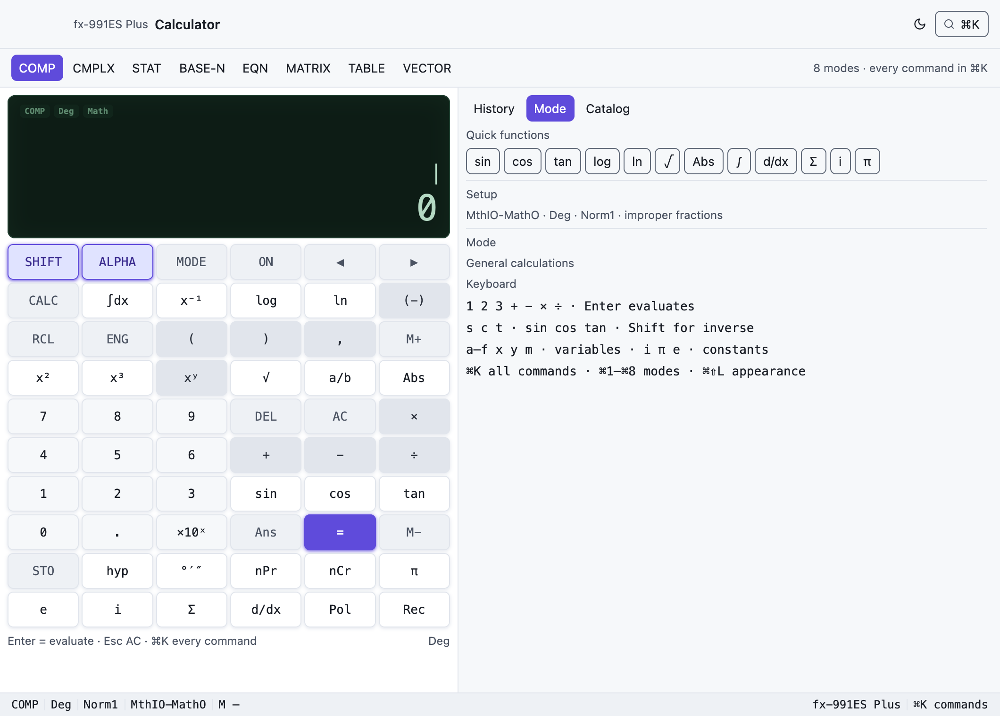

# Calculator — a native fx-991ES Plus

A macOS-feeling Casio **fx-991ES Plus**, rendered by GPUix through
`@gpuixui/*`, with every mode in the manual, full keyboard control, a ⌘K
palette over every function/constant/setup command, light and dark appearance,
and the same tree in a kitty/Ghostty terminal.




## Run it

```sh
nub run --filter @gpuixui/calculator dev          # native window
nub run --filter @gpuixui/calculator terminal     # kitty / Ghostty
nub run --filter @gpuixui/calculator dev -- --dark
```

`GPUIX_TERMINAL=1` is equivalent to the terminal flag; `GPUIX_DARK=1` starts in
dark. The terminal run paints the same app: the traffic-light reserve drops, and
the frame is transmitted with the kitty graphics protocol.

The mount is `src/main.tsx` — the only file that executes anything. Window
options come from `nativeWindowOptions(theme, currentPlatform)`; the app owns the
appearance and restyles every token-driven surface.

## Controls

| Input | Action |
| ----- | ------ |
| digits, `.` `+` `−` `×` `÷` `^` `( )` `,` | entry |
| Enter | `=` |
| Escape | AC |
| Backspace | DEL |
| arrows | cursor / history at a result / editor movement |
| `a/b` | insert a stacked fraction; `→`/`←` move between slots |
| `√` | insert a radical slot; `^` a superscript slot |
| `s` `c` `t` | sin cos tan; Shift for inverses |
| `l` `g` `r` `p` `e` `i` | ln, log, √, π, e, i |
| `a`–`f` `x` `y` `m` | variables / independent memory |
| `h` | hyp latch, then sin/cos/tan for hyperbolic; Shift+hyp for inverses |
| ⌘K | search every mode, function, constant, conversion and setup command |
| ⌘1…⌘8 | COMP · CMPLX · STAT · BASE-N · EQN · MATRIX · TABLE · VECTOR |
| ⌘⇧L | light/dark appearance |
| ⌘, | SETUP |
| ⌘⇧Q | power the LCD off (any key wakes) |
| ⌘H | focus the history inspector |

The on-screen **SHIFT** and **ALPHA** keys latch for one keypress, exactly as
the display indicators say. **hyp** latches a hyperbolic menu; the next sin/cos/tan
picks it.

## What the window shows

- **Toolbar** — model name, appearance switch, ⌘K.
- **Mode rail** — the manual's eight modes; the active mode is the primary
  button.
- **LCD** — status indicators (SHIFT, ALPHA, M, STO, RCL, STAT, CMPLX, MAT, VCT,
  angle, FIX/SCI, Math, history), the entry with a caret, and the result. Matrix,
  vector, table and STAT results use the result rows.
- **Keypad** — painted from `fx991es.keypad`; the app owns no second layout.
- **Inspector** — history (click to replay), the mode's editor (STAT grid, EQN
  coefficients, MATRIX/VECTOR cells, TABLE range, BASE-N switch), and the
  manual's 40 constants and 40 conversions in the Catalog tab.
- **Status bar** — mode, angle, number format, display format, memory, and the
  palette hint.

## Coverage and honesty

The engine lives in [`@gpuixui/calc`](../../packages/calc); its README carries the
mode-by-mode matrix and the limitations. The important ones:

- **Natural Display input and output** are native structure: `a/b` inserts a
  stacked fraction with the caret in the numerator, `→` jumps to the denominator,
  `DEL` edits in place; `√( … )` paints a radical with a vinculum; `^`/`x²` paint
  superscripts. Outputs paint stacked fractions, radicals, π coefficients and
  two-term √ sums (`√6 + 2√3`). LineIO stays linear.
- **SETUP** opens with SHIFT + MODE (or ⌘,): display, angle, Fix/Sci/Norm,
  fractions, complex format, STAT frequency, decimal point and contrast.
  SHIFT + AC (or ⌘⇧Q) powers the LCD off; any key wakes it.
- **VERIFY** is not in this model's manual. It is marked absent and never faked.
- STAT frequency, all seven regressions, estimates and P/Q/R/t are implemented;
  the inspector shows the first eight data rows at a time and the editor scrolls
  by keyboard.
- The TERMINAL run was verified in a pseudo-terminal: the renderer reported
  `[gpuix] mount complete` and transmitted frames with `_Ga=T` kitty graphics.
  No window server is touched in that mode.

## Tests

```sh
nub run --filter @gpuixui/calculator test           # app logic (6)
nub run --filter @gpuixui/calculator test:native    # real GPUix renderer (12)
nub run --filter @gpuixui/calc test                 # engine (82)
```

The native suite mounts the real app and asserts: the window/keypad/display
exist, pointer presses on `1 + 2 =` paint `3`; the `a/b` key paints a stacked
input fraction, `→` moves to its denominator, `DEL` edits a slot and re-evaluates;
a `√` slot evaluates; SHIFT + MODE opens SETUP and changes the angle; contrast
changes the LCD ink; SHIFT + AC powers off and a key wakes it; the mode rail
opens the matrix editor; `⌘K` finds `det(MatA)`; and the appearance switch
repaints the body. The screenshots above are
produced by `nub run --filter @gpuixui/calculator capture` from the same renderer.

## The TI-84 seam

`@gpuixui/calc` exposes a `CalculatorModel` (`id`, `label`, `modes`, `keypad`,
`capabilities`, `catalog`) and resolves it through `models`/`modelOf`. The app
imports `defaultModel`, never a concrete fx-991ES implementation. A TI-84 lands
as `models/ti84.ts` plus its keypad/catalogue and a capability row; the window,
palette, inspector and session wiring stay put. Model-specific menu behaviour is
an action in the catalogue, so the app has no `if fx991es` branch.
