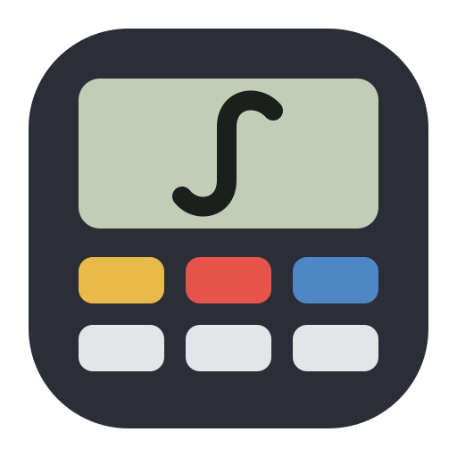
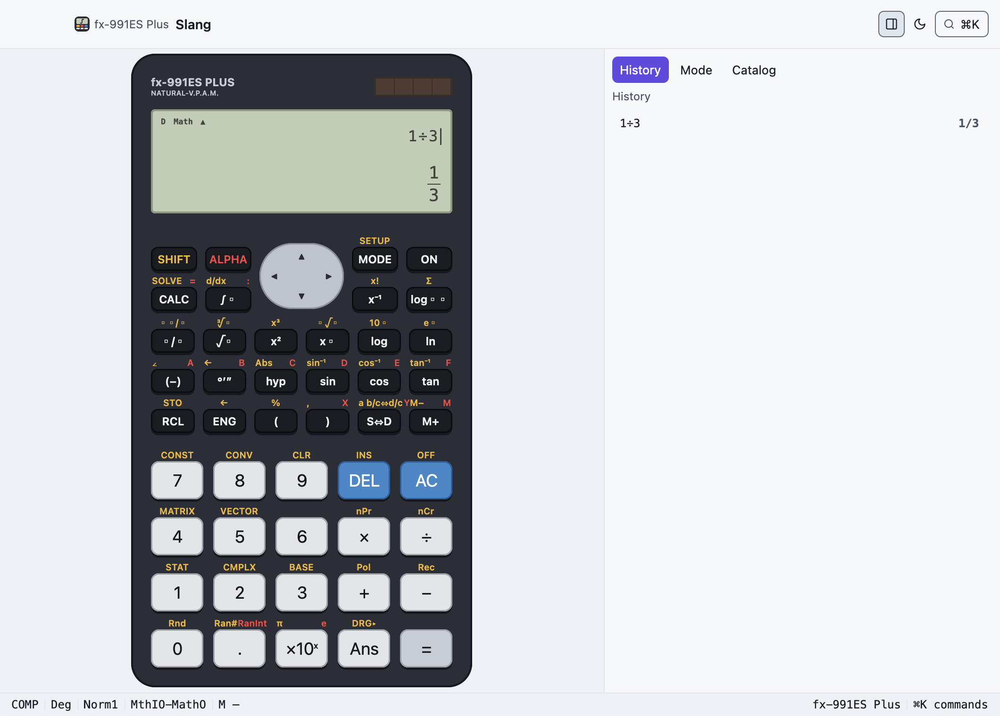
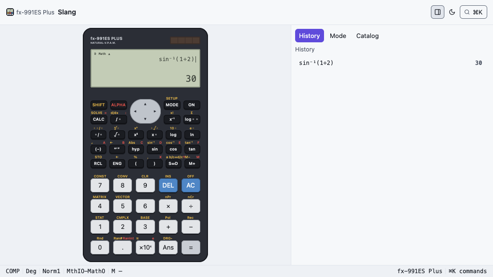

<p align="center">
  
</p>

<h1 align="center">Slang</h1>

<p align="center">
  The scientific calculator you learned on, as a native app.<br>
  GPU-rendered by GPUix · in a window or a terminal · every mode in the manual
</p>

<p align="center">
  
</p>

Slang is the fx-991ES Plus with nothing changed: the same key grid, the gold
SHIFT and red ALPHA legends above every key, the grey-green LCD with the result
on the second line. On top of that it adds what a desktop is good at: a history
you can scroll and replay, editors for matrices, vectors, statistics and
equations, full keyboard control, and ⌘K over every function, constant and setup
command.

It is built from [GPUIxUI](../../README.md) components and the
[`@gpuixui/calc`](../../packages/calc) engine. There is no web view: the tree is
painted by GPUI.

## Run it

```sh
nub run --filter @gpuixui/slang dev               # native window
nub run --filter @gpuixui/slang dev -- --dark     # start in the dark appearance
nub run --filter @gpuixui/slang terminal          # kitty / Ghostty
```

`GPUIX_TERMINAL=1` and `GPUIX_DARK=1` do the same as the flags. In a terminal
the frames go out through the kitty graphics protocol and the mouse works. The
device scales to fit, so even a 1024×576 terminal shows all of it.

<p align="center">
  
</p>

## Features

| | |
| --- | --- |
| **Eight modes** | COMP, CMPLX, STAT, BASE-N, EQN, MATRIX, TABLE, VECTOR, as the manual defines them |
| **Natural Display** | Stacked fractions, radicals with a vinculum, superscripts, π coefficients and `√6 + 2√3` results, in input and output |
| **The real keypad** | Every SHIFT and ALPHA legend does what it says: SHIFT RCL stores, SHIFT hyp is Abs, ALPHA (−) is A |
| **Device menus** | MODE lists the modes on the LCD; SHIFT MODE opens SETUP; SHIFT 7/8 open the 40 constants and 40 conversions |
| **Side panel** | History (click to replay), the mode's editor and the catalogue, folded away with ⌘H or the toolbar |
| **⌘K** | Search every function, mode, constant, conversion and setup command: `hex`, `regression`, `determinant`, `constant 28` |
| **Appearance** | The window follows light and dark; the calculator keeps its physical colours, as a real one does |

## Keyboard

| Keys | Action |
| --- | --- |
| digits, `.` `+` `−` `×` `÷` `^` `( )` `,` | entry |
| Enter · Escape · Backspace | `=` · AC · DEL |
| arrows | move the cursor; replay history at a result; move in an editor |
| `s` `c` `t` · `l` `g` `r` | sin cos tan (Shift for inverses) · ln log √ |
| `p` `e` `i` | π, e, i |
| `a`–`f` `x` `y` `m` | variables and the independent memory |
| ⌘K | the command palette |
| ⌘1 … ⌘8 | switch mode |
| ⌘H | show or hide the side panel |
| ⌘, · ⌘⇧L · ⌘⇧Q | SETUP · appearance · power off |

On the keypad, SHIFT and ALPHA latch for one press and the LCD shows `S` or `A`
while they are held. SHIFT AC powers off, and any key wakes it.

## How it is built

```
examples/slang/src
  main.tsx         the mount: window options, --terminal, --dark
  App.tsx          window, toolbar, device frame, side panel, palette, menus
  keypad.tsx       the keypad, painted from the model's key table
  display.tsx      the LCD: indicators, entry, result, the MODE menu
  mathview.tsx     Natural Display layout (fractions, radicals, powers)
  inspector.tsx    history, the mode editors, the catalogue
  setup-sheet.tsx  SETUP
  app-logic.ts     palette rows, MODE menu, SHIFT menus, device fit (pure)
  theme.ts         the device's physical colours, the app's only literals
```

- **The model is the authority.** The keypad, legends, modes and catalogue
  come from `fx991es` in `@gpuixui/calc`. The app has no second layout and no
  `if fx991es` branch. A TI-84 would be a new `CalculatorModel` with its own
  keypad and catalogue, and the window, palette and panel would stay as they are.
- **One interpreter.** A key press, a keyboard shortcut and a palette command
  all go through the engine's session (`press` / `runAction`), an Effect state
  machine with errors modelled as data.
- **One unit.** The device is laid out in a unit fitted to the space it gets
  (GPUix has no transforms), so it is the same tree at every size.

## Tests

```sh
nub run --filter @gpuixui/calc test           # engine: 87, including the manual's worked examples
nub run --filter @gpuixui/slang test          # app logic: 9
nub run --filter @gpuixui/slang test:native   # the real GPUix renderer: 15
nub run --filter @gpuixui/slang capture       # regenerate the screenshots
```

The native suite mounts the app and drives it with real pointer presses.
`1 + 2 =` paints `3`. Fraction and radical slots edit in place. MODE then `6`
opens MATRIX. SHIFT 7 opens the catalogue. The panel folds away and comes back.
SETUP changes the angle and the contrast. SHIFT AC powers off. ⌘K finds
`det(MatA)`. In a 1024×576 window the whole device fits and `7 × 6 =` paints
`42`.

The terminal run was verified in a pseudo-terminal with the film's terminal rig
(`apps/playground/src/film/terminal-take.ts`). Typing
`SHIFT sin 1 ÷ 2 ) =` painted `sin⁻¹(1÷2)` and `30`.

## Limitations

- These printed legends are not wired yet: mixed fractions (SHIFT ▫/▫), INS,
  DRG▸, the sexagesimal `←` and a b/c⇔d/c. They are listed with a `// TODO:`
  in `packages/calc/src/model.test.ts`.
- ENG and SHIFT ENG turn engineering notation on and off. They do not step the
  exponent by three per press.
- VERIFY is not in this model's manual, so it is marked absent rather than
  imitated.
- The full mode-by-mode matrix is in the
  [`@gpuixui/calc` README](../../packages/calc/README.md).

## Credits

Slang reproduces the layout of the Casio fx-991ES Plus so that people who know
the device can use it without learning anything new. Casio and fx-991ES are
trademarks of Casio Computer Co., Ltd. Slang is not affiliated with or endorsed
by Casio, and it does not use Casio's logo.
