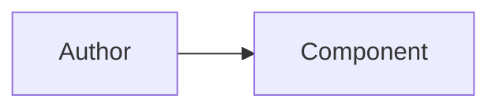

A **diagram** is a drawing, and this is the component that draws one. You give
it a Mermaid source and it renders the diagram, themed in the library's own
colours.

<ComponentPreview name="diagram-demo" />

The renderer is [Pele](https://pele.run) — a zero-dependency Mermaid renderer
that needs no DOM. Measured in a plain Node process, with `typeof document` and
`typeof window` both `undefined`, a flowchart rendered to a 403×64 SVG.

The drawing travels as one image, so the whole diagram is **one element** in
the frame.

## Usage

```tsx
import { Diagram } from "@gpuixui/components/diagram";

<Diagram
  aria-label="The render path"
  source={"flowchart LR\n  A[Author] --> B[Component]"}
  caption="How a component becomes a picture"
/>;
```

## The source is the API

A diagram is written in Mermaid, and the fence is the whole interface:

````mdx

````

Every diagram type Mermaid 12.1 knows is supported, because Pele renders all of
them. A source the parser refuses paints the parser's sentence in the
drawing's place — the reader sees what went wrong rather than an empty frame.

## Theming

Pele writes its palette as CSS custom properties. A raster cannot read them,
so the component reads the theme and **bakes the values into** the drawing.

| Pele role | The library's role |
| --- | --- |
| `--pele-bg` | `card` |
| `--pele-fg` | `foreground` |
| `--pele-muted` | `muted-foreground` |
| `--pele-line` | `border-strong` |
| `--pele-surface` | `muted` |
| `--pele-surface-alt` | `accent` |
| `--pele-accent` | `primary` |
| `--pele-border` | `border` |

The three roles that are not colours — `--pele-radius`, `--pele-font` and
`--pele-font-mono` — are given literal values, because a raster carries no
font of its own.

## API

| Prop | Type | Default | Consequence |
| ---- | ---- | ------- | ----------- |
| `source` | `string` | — | the Mermaid source; the whole interface |
| `label` | `string` | the host's `aria-label` | the drawing's name for a reader |
| `caption` | `string` | — | a line of words under the drawing |
| `maxWidth` | `number` | — | the width the drawing may use, so a narrow box adapts the layout |
| `fontSize` | `number` | — | the base font size, in pixels |
| `idPrefix` | `string` | — | the prefix on the drawing's ids, so two diagrams on one page do not collide |
| `className` | `string` | — | a class string, joined after the recipe so it wins conflicts |
| `style` | `StateStyle` | — | the caller's style, merged last |
| `children` | `ReactNode` | — | what a caller paints beside the drawing — a legend, a note |
| `testId` | `string` | — | the test id the drawing and the failure state answer to |
